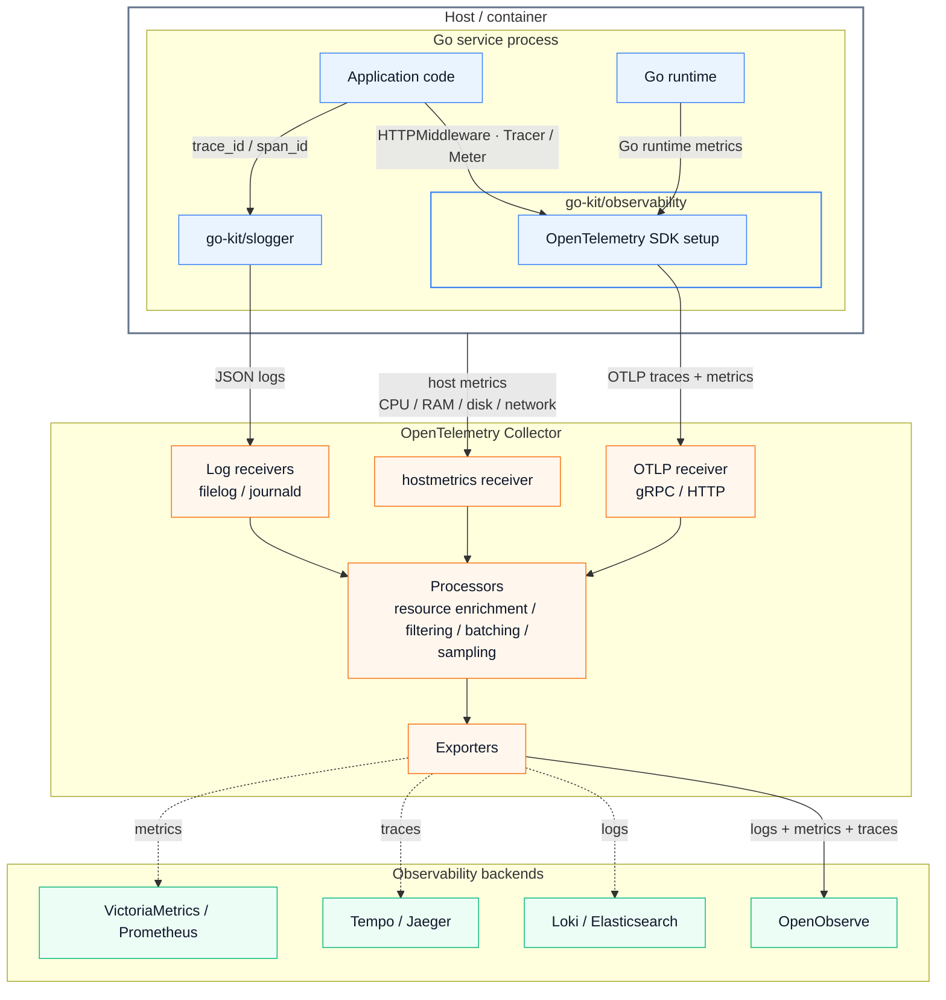

# Архитектура observability

Схема показывает путь observability-сигналов от Go-сервиса до backend-ов хранения и анализа.

Пакет `observability` отвечает за Go-side часть: настройку OpenTelemetry SDK, HTTP мониторинг через `otelhttp`, сбор метрик `Go runtime`, `custom Tracer/Meter` и экспорт `traces/metrics` по OTLP.

`slogger` пишет JSON-логи с `trace_id`/`span_id` в `stderr` или файл, а Collector читает их через `filelog` или `journald`

Сбор `host metrics` и логов, обработка сигналов и маршрутизация в один или несколько backend-ов относятся к инфраструктурному слою и настраиваются в конфигурации Collector

